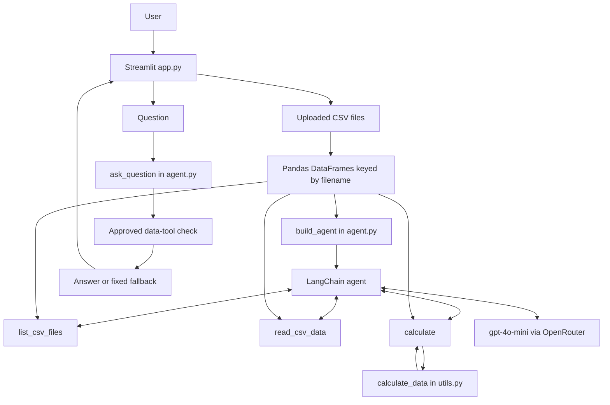

# Hello Agent

Hello Agent is a beginner-friendly CSV question-answering application. Upload
one or more CSV files in the Streamlit interface, then ask a question in plain
English. The agent uses a small set of tools to inspect CSV data and perform
basic numeric calculations.

## 1. Project overview

The project combines a Streamlit user interface, Pandas data handling, a
LangChain agent, and the `gpt-4o-mini` model through OpenRouter's
OpenAI-compatible API. The application is designed to answer from the CSVs
provided for a session, rather than from general knowledge.

## 2. Problem statement

Finding an answer in several CSV files can require manually opening files,
identifying the relevant dataset, and searching or calculating values. Hello
Agent provides one interface for uploading those files and asking questions
about their contents.

## 3. Project objectives

- Accept one or more CSV files through a simple web interface.
- Preview uploaded data so users can check what was loaded.
- Let a user ask a question without writing a query.
- Route questions to a small set of CSV-specific tools.
- Perform a limited set of numeric calculations with Pandas.
- Return a fixed fallback when the agent has not used a data-reading or
  calculation tool.

## 4. Features

- Multiple CSV uploads in Streamlit.
- Pandas DataFrames stored by uploaded filename.
- A preview of the first five rows of each readable upload.
- Natural-language question input and an **Ask Agent** button.
- A spinner while the agent is working.
- User-visible messages for missing uploads, blank questions, and common CSV
  parsing or decoding errors.
- CSV listing, CSV record reading, and numeric calculation tools.
- A fixed no-answer response:

  > I could not find this information in the uploaded files.

- A command-line mode in `agent.py` that loads CSV files from the local
  `data/` folder.

## 5. Technology stack

- **Python** — application language.
- **Streamlit** — web interface.
- **Pandas** — CSV loading, DataFrames, previews, and calculations.
- **LangChain** — agent and tool integration.
- **LangChain OpenAI integration** — model client.
- **OpenRouter** — API endpoint configured with `gpt-4o-mini`.
- **python-dotenv** — local environment-variable loading.
- **pytest** — utility tests.

Dependencies are listed in `requirements.txt`.

## 6. Application architecture



In the Streamlit flow, uploaded DataFrames are passed into `build_agent`.
`utils.py` contains the reusable calculation logic. The command-line entry
point in `agent.py` instead loads CSV files from the project's local `data/`
folder.

## 7. Agent execution workflow

1. The user uploads CSV files and enters a question in Streamlit.
2. `app.py` reads each file with `pandas.read_csv` and stores each DataFrame
   under its uploaded filename.
3. When **Ask Agent** is clicked, the app checks that there are valid uploads
   and that the question is not blank.
4. `build_agent(dataframes)` creates the LangChain agent and its tools.
5. The agent can list available filenames, read a CSV as JSON records, or
   calculate a supported numeric operation.
6. `ask_question(agent, question)` invokes the agent and checks its messages
   for a `ToolMessage` from `read_csv_data` or `calculate`.
7. If neither approved data tool ran, the function returns the fixed fallback.
   Otherwise, it returns the agent's final message.

## 8. Project folder structure

```text
hello_agent/
├── .env.example             # Blank template for the API key
├── .gitignore               # Excludes .env and Python-generated files
├── README.md
├── agent.py                 # Agent, prompt, tools, and CLI entry point
├── app.py                   # Streamlit interface
├── requirements.txt         # Python dependencies
├── utils.py                 # Pandas calculation helper
├── data/                    # Example CSV datasets used by CLI mode
│   ├── credit_card_terms.csv
│   ├── ecommerce_faqs.csv
│   ├── hospital_policy.csv
│   ├── saas_docs.csv
│   └── sales.csv
└── tests/
    └── test_utils.py        # pytest tests for calculations
```

The repository also contains `explore_data.py`, `test_langchain.py`, and
`test_llm.py` as standalone learning or connection-check scripts, plus a
`Data/` directory. They are not required to run the Streamlit application.
The documented unit tests are in `tests/test_utils.py`.

## 9. Installation

Use Python 3.10 or later. Run commands from the project directory.

### macOS

```bash
python3 -m venv .venv
source .venv/bin/activate
python -m pip install --upgrade pip
pip install -r requirements.txt
```

### Windows PowerShell

```powershell
py -m venv .venv
.\.venv\Scripts\Activate.ps1
python -m pip install --upgrade pip
pip install -r requirements.txt
```

If PowerShell prevents environment activation, use the Python executable in
`.venv\Scripts\python.exe` to install dependencies and run the application.
Follow your organization's security policy before changing PowerShell's
execution policy.

## 10. API key configuration

The current implementation uses **OpenRouter**, not the OpenAI API directly.
It configures the OpenAI-compatible client with OpenRouter's base URL and
reads the `OPENROUTER_API_KEY` environment variable.

1. Copy `.env.example` to `.env`.
2. Add your own OpenRouter API key after the equals sign:

   ```dotenv
   OPENROUTER_API_KEY=your_key_here
   ```

3. Save `.env` in the project root.

The `.env` file is listed in `.gitignore`; do not commit it or put real keys in
`.env.example`, source code, screenshots, or shared logs. The example file
contains only a blank setting. `build_agent` loads `.env` and reports an error
if the key is not available.

## 11. Run the Streamlit application

Activate the virtual environment, configure `.env`, and run:

```bash
streamlit run app.py
```

Use the browser page opened by Streamlit to upload CSV files, review their
previews, enter a question, and select **Ask Agent**.

The CLI mode is also available:

```bash
python agent.py
```

CLI mode reads CSV files from the local `data/` folder and prompts for a
question. The Streamlit app uses the files uploaded by the user instead.

## 12. Sample questions and expected responses

These are representative facts available in the included CSVs. The model's
wording may vary, except the missing-information fallback is intended to be
exact.

| Question | Expected result from the included data |
|---|---|
| How long does standard shipping take? | The `ecommerce_faqs.csv` data says standard domestic shipping typically takes 3–5 business days; rural areas may take up to 7 business days. |
| What is the API rate limit for the Free plan? | `saas_docs.csv` lists 1,000 API requests per day for Free. |
| What is the API rate limit for the Enterprise plan? | `saas_docs.csv` lists 1,000,000 requests per day and burst handling up to 500 requests per second. |
| What is the total Sales value? | For `sales.csv`, summing the `Sales` column gives 99,000. |
| What is the API rate limit for the Premium plan? | No Premium API rate-limit row is present in `saas_docs.csv`; expected fallback: `I could not find this information in the uploaded files.` |

The included ecommerce file has a separate Premium Membership FAQ; it does not
describe a Premium API rate limit.

## 13. Custom agent tools

The tools are defined inside `build_agent(dataframes)` in `agent.py`, allowing
them to use the DataFrames provided to that agent.

- **`list_csv_files`** — returns the available CSV filenames.
- **`read_csv_data(filename)`** — returns the selected DataFrame as JSON
  records. It returns `"File not found."` for an unknown filename.
- **`calculate(filename, operation, column)`** — calls `calculate_data` in
  `utils.py`. Supported operations are `count`, `sum`, `mean`, `min`, and
  `max`. Count returns the number of DataFrame rows; the other operations
  require an existing numeric column.

Custom Pandas tools are used instead of unrestricted Python execution because
they expose a small, explicit set of operations over the uploaded DataFrames.
This keeps the agent's capabilities predictable and avoids giving model output
a general-purpose code-execution path. It also makes calculations easier to
test. This design reduces risk; it does not make the application immune to
incorrect model behavior or malicious input.

## 14. Unit testing

From the project directory with the virtual environment activated, run:

```bash
pytest -q tests/test_utils.py
```

The tests cover sum, mean, count, minimum, maximum, an invalid column, a
non-numeric column, an empty numeric column, and an unsupported operation.
They test the local calculation helper and do not require API access.

## 15. Hallucination prevention and prompt-injection guardrails

- The system prompt tells the model to answer only from CSV data, avoid
  guessing and general knowledge, and use the exact fallback when information
  is unavailable.
- It identifies filenames, column names, and cell contents as untrusted data,
  and tells the model not to follow instructions found in CSV content.
- `ask_question` checks that `read_csv_data` or `calculate` generated a
  `ToolMessage` before it returns the agent's final text. If not, it returns
  the fixed fallback. Listing filenames alone does not satisfy this check.
- No unrestricted Python-execution tool is exposed to the model.

These are safeguards, not guarantees. A tool-call check confirms that an
approved tool ran; it does **not** prove that the final answer is supported by
the tool's result. The model can still misunderstand data, and prompt
instructions cannot completely prevent hallucinations or prompt-injection
attempts.

## 16. Current limitations

- The agent receives complete CSV records from `read_csv_data`; large files
  can exceed model context limits, increase cost, or slow down responses.
- Tool selection and the final wording are still controlled by an LLM.
- The programmatic guardrail verifies tool use, not factual grounding of each
  statement.
- Numeric calculations support only count, sum, mean, minimum, and maximum.
- CSV uploads are held in the running app's memory and are not persisted by
  this project.
- There is no user authentication, access control, or multi-user data
  isolation feature implemented here.
- API/network failures are not given a dedicated retry or recovery workflow.
- The project does not include automated tests for the full LangChain/OpenRouter
  interaction or Streamlit interface.

## 17. Future enhancements

- Add retrieval or row filtering so large CSVs do not need to be sent in full.
- Add integration tests for tool calls and the Streamlit interaction using
  mocked model responses.
- Provide clearer handling for API errors, rate limits, and timeouts.
- Add support for additional safe, explicitly defined operations.
- Add schema validation and clearer reports for duplicate filenames or
  inconsistent CSV formats.
- Add optional conversation history with a clear reset control.
- Add authentication and deployment-specific protections if the application
  is hosted for multiple users.
